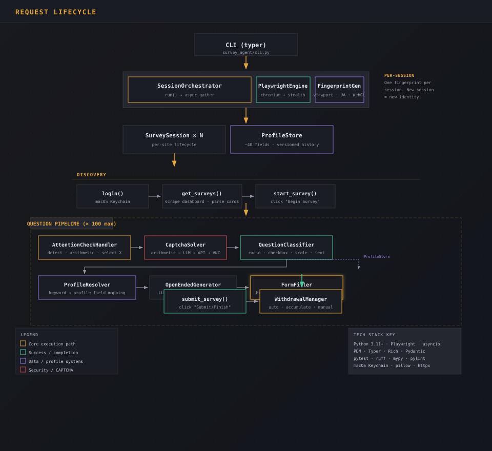
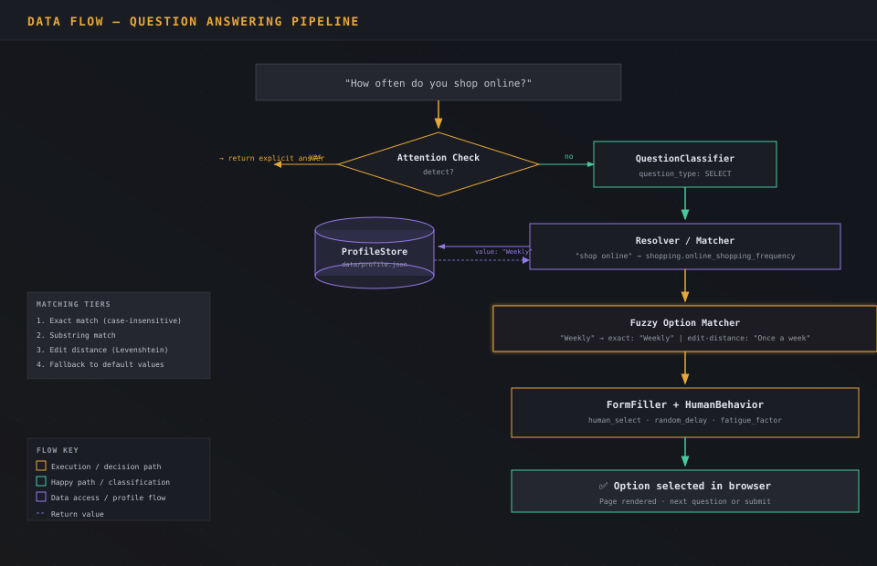

# Survey Agent 🤖📋

**Agent-driven survey automation system** — an intelligent bot that autonomously
logs into paid survey platforms, discovers available surveys, answers questions
consistently using a user-defined profile, handles CAPTCHAs, and manages
withdrawals.

Built with Python and Playwright, designed to run headlessly with anti-detection
measures that make automated interactions indistinguishable from human behavior.

## Table of Contents

- [Key Features](#key-features)
- [Tech Stack](#tech-stack)
- [How It Works](#how-it-works)
- [Prerequisites](#prerequisites)
- [Getting Started](#getting-started)
  - [1. Clone the Repository](#1-clone-the-repository)
  - [2. Install Dependencies](#2-install-dependencies)
  - [3. Install Playwright Browsers](#3-install-playwright-browsers)
  - [4. Set Up Your Profile](#4-set-up-your-profile)
  - [5. Store Site Credentials](#5-store-site-credentials)
  - [6. Run the Agent](#6-run-the-agent)
- [Architecture](#architecture)
  - [Directory Structure](#directory-structure)
  - [Request Lifecycle](#request-lifecycle)
  - [Data Flow](#data-flow)
  - [Key Components](#key-components)
- [CLI Reference](#cli-reference)
  - [Global Commands](#global-commands)
  - [Profile Management](#profile-management)
  - [Credential Management](#credential-management)
  - [Status & Configuration](#status--configuration)
- [Configuration](#configuration)
  - [Configuration File](#configuration-file)
  - [Anti-Detection Settings](#anti-detection-settings)
  - [CAPTHA Solving Settings](#captcha-solving-settings)
  - [Per-Site Configuration](#per-site-configuration)
- [Profile System](#profile-system)
  - [Profile Categories](#profile-categories)
  - [How Answering Works](#how-answering-works)
- [Supported Sites](#supported-sites)
- [Troubleshooting](#troubleshooting)
- [License](#license)

---

## Key Features

- **🧠 Autonomous Survey Completion** — Logs into survey platforms, discovers
  available surveys, and completes them end-to-end.
- **👤 Consistent Persona** — Answers every question using a single, detailed
  user profile you define. Answers are consistent across all survey sessions.
- **🕵️ Anti-Detection** — Rotates browser fingerprints (viewport, user-agent,
  WebGL, timezone, locale), uses proxy rotation, and mimics human behavior
  (typing speed variation, mouse movement delays, scrolling patterns, reading
  pauses).
- **🧩 Attention Check Handling** — Automatically detects and correctly responds
  to attention check questions (e.g., "To show you're paying attention, select
  'Strongly Agree'").
- **🛡️ CAPTCHA Pipeline** — Four-tier CAPTCHA solving: arithmetic, LLM vision,
  external API (2captcha/CapSolver), and manual VNC fallback.
- **🔑 Secure Credential Storage** — Credentials are stored in the macOS
  Keychain via `keyring`, never in plaintext files.
- **🔌 Extensible Site Adapters** — Plugin architecture for adding new survey
  platforms. Currently supports Branded Surveys with a clean interface for more.
- **📊 Session Orchestration** — Runs concurrent survey sessions with
  per-session fingerprint rotation and configurable concurrency.
- **💵 Withdrawal Automation** — Automatically withdraws earnings when balance
  thresholds are met, configurable per site.
- **📝 Open-Ended Question Support** — Generates natural-sounding free-text
  answers using LLM prompts grounded in the user profile.

---

## Tech Stack

| Layer                  | Technology                         |
| ---------------------- | ---------------------------------- |
| **Language**           | Python 3.11+                       |
| **Package Manager**    | PDM                                |
| **Browser Automation** | Playwright with playwright-stealth |
| **CLI Framework**      | Typer                              |
| **Configuration**      | Pydantic + YAML                    |
| **Credential Storage** | macOS Keychain (via `keyring`)     |
| **Terminal Output**    | Rich                               |
| **HTTP Client**        | httpx                              |
| **Image Processing**   | Pillow                             |
| **Testing**            | pytest + pytest-asyncio            |

---

## How It Works

At a high level, the system follows this loop:

1. **Launch** — The orchestrator spins up N headless Chromium browsers
   (configurable), each with a unique browser fingerprint.
2. **Login** — For each configured site, the agent logs in using credentials
   from the macOS Keychain.
3. **Survey Discovery** — The agent scans the dashboard for available surveys.
4. **Question Pipeline** — For each survey question:
   - **Detect** attention checks → follow the explicit instruction.
   - **Classify** the question type (radio, checkbox, scale, open-ended, etc.).
   - **Resolve** the best answer by matching the question text to the user
     profile.
   - **Simulate** human interaction to fill in the answer (delayed typing,
     varied clicking).
   - **Handle** any CAPTCHAs using the tiered solver.
5. **Submit** — Once all questions are answered, the survey is submitted.
6. **Withdraw** — If the balance exceeds the configured threshold, an automatic
   withdrawal is triggered.
7. **Rotate** — Between sessions, the fingerprint is rotated to avoid detection.

---

## Prerequisites

- **Python 3.11 or higher**
- **PDM** — Python package manager (`pip install pdm` or `brew install pdm`)
- **macOS** (for Keychain credential storage; other OSes work with a different
  keyring backend)
- **A survey site account** (e.g., Branded Surveys)

---

## Getting Started

### 1. Clone the Repository

```bash
git clone https://github.com/your-org/survey-agent.git
cd survey-agent
```

### 2. Install Dependencies

The project uses PDM for dependency management:

```bash
pdm install
```

This creates a virtual environment in `.venv/` and installs all runtime
dependencies.

To include development dependencies (pytest):

```bash
pdm install -d
```

### 3. Install Playwright Browsers

Playwright requires browser binaries:

```bash
pdm run playwright install chromium
```

### 4. Set Up Your Profile

Run the interactive profile setup to define your survey persona:

```bash
pdm run survey-agent profile setup
```

This walks you through ten categories of questions covering demographics,
employment, income, education, health, shopping, politics, household,
technology, and lifestyle. Answer as consistently as you want your survey
persona to appear.

You can view your profile at any time:

```bash
pdm run survey-agent profile show
```

Or update individual fields:

```bash
pdm run survey-agent profile update demographics.age 35
```

The profile is stored as JSON in `data/profile.json` with a full change history
in `data/profile_history.json`.

### 5. Store Site Credentials

Credentials are stored securely in the macOS Keychain — never in plaintext
files:

```bash
pdm run survey-agent credentials set branded-surveys --username you@example.com
```

You'll be prompted for your password. To verify credentials are stored:

```bash
pdm run survey-agent credentials check branded-surveys
```

### 6. Run the Agent

Start the agent:

```bash
pdm run survey-agent run
```

This runs one headless session on the default site (Branded Surveys), completing
up to 5 surveys.

**Common options:**

```bash
# Run on multiple sites (once more are supported)
pdm run survey-agent run --site branded-surveys --site opinionspot

# Complete more surveys per session
pdm run survey-agent run --max 15

# Run multiple concurrent sessions
pdm run survey-agent run --sessions 3

# Run with visible browser (for debugging)
pdm run survey-agent run --no-headless
```

---

## Architecture

### Directory Structure

```
survey-agent/
├── survey_agent/
│   ├── __init__.py                 # Package init, version
│   ├── cli.py                      # Typer CLI entry point
│   ├── config.py                   # Pydantic config models + YAML persistence
│   ├── credentials.py              # macOS Keychain credential store
│   ├── orchestrator.py             # Session orchestrator + survey session loop
│   ├── run.py                      # Convenience entry point
│   ├── withdrawal.py               # Withdrawal automation manager
│   │
│   ├── browser/                    # Browser automation layer
│   │   ├── engine.py               # Abstract interfaces (BrowserEngine, BrowserContext, BrowserPage)
│   │   ├── playwright_engine.py    # Playwright implementation with stealth
│   │   ├── fingerprint.py          # Browser fingerprint generation
│   │   ├── human_behavior.py       # Human-like interaction simulation
│   │   ├── proxy_manager.py        # Residential proxy rotation
│   │   └── session_identity.py     # Per-session fingerprint management
│   │
│   ├── sites/                      # Survey site adapters (plugin system)
│   │   ├── base.py                 # Abstract SiteAdapter + data models
│   │   ├── branded_surveys.py      # Branded Surveys adapter
│   │   └── registry.py             # Auto-discovery adapter registry
│   │
│   ├── answering/                  # Question answering pipeline
│   │   ├── question_classifier.py  # Question type classification (radio, scale, open_ended, etc.)
│   │   ├── matcher.py              # Profile-to-question matching + fuzzy option resolution
│   │   ├── form_filler.py          # Form input interaction per type
│   │   ├── open_ended.py           # LLM-powered open-ended answer generation
│   │   └── attention_check.py      # Attention check detection and handling
│   │
│   ├── captcha/                    # CAPTCHA solving pipeline
│   │   └── solver.py              # Tiered solver (arithmetic → LLM vision → API → VNC)
│   │
│   └── profile/                    # User profile management
│       ├── store.py                # JSON profile store with versioned history
│       ├── categories.py           # 10 profile categories with ~40 field definitions
│       ├── resolver.py             # Keyword-based question-to-profile mapping
│       └── interview.py            # Interactive profile setup interview
│
├── data/
│   ├── config.yaml                 # Application configuration
│   ├── profile.json                # User profile (populated by `profile setup`)
│   └── profile_history.json        # Profile change history
│
├── tests/                          # Test directory
├── pyproject.toml                  # Project metadata and dependencies
├── pdm.lock                        # Locked dependency versions
├── CLAUDE.md                       # GitNexus-generated code intelligence docs
└── AGENTS.md                       # GitNexus code intelligence rules
```

### Request Lifecycle



### Data Flow



The diagrams above use the [Aigency brand design system](brand-spec.md) — deep
void backgrounds, amber warm accents, JetBrains Mono typography, sharp corners,
and dot-matrix grid beams. Also see the
[CAPTCHA solving pipeline](diagram/captcha-pipeline.svg).

### Key Components

#### Browser Engine (`survey_agent/browser/`)

The browser abstraction layer is designed to be swappable. Currently powered by
Playwright with the `playwright-stealth` plugin to avoid automation detection.

- **Abstract Interfaces** (`engine.py`) — `BrowserEngine`, `BrowserContext`,
  `BrowserPage` define a clean contract. In theory, any automation library
  (Camoufox, Selenium, Puppeteer) could replace Playwright by implementing these
  interfaces.
- **Fingerprint Rotation** (`fingerprint.py`) — Generates random but internally
  consistent browser fingerprints: viewport resolution, user-agent string,
  locale, timezone, WebGL renderer, hardware concurrency, device memory, color
  scheme. The generator ensures consistency (e.g., Windows user-agent gets a
  Windows platform and GPU).
- **Human Behavior Simulation** (`human_behavior.py`) — Adds realistic delays
  and interaction patterns: character-by-character typing with varying speed,
  occasional longer pauses ("thinking"), pre-click delays, post-click delays,
  natural scrolling, and reading pauses proportional to text length. A fatigue
  factor increases delays slightly over time to simulate growing tired.
- **Proxy Rotation** (`proxy_manager.py`) — Manages a pool of proxies with
  round-robin or random selection. Supports HTTP/HTTPS/SOCKS proxies with
  authentication.
- **Session Identity** (`session_identity.py`) — One fingerprint per session;
  new session = new fingerprint.

#### Site Adapters (`survey_agent/sites/`)

Survey platforms are modeled as plugins. Each adapter implements the
`SiteAdapter` abstract class:

- `login()` / `is_logged_in()` / `logout()`
- `get_surveys()` — Discover available surveys from the dashboard
- `start_survey()` — Navigate into a survey
- `get_current_question()` — Parse the current question from the DOM
- `answer_question()` — Submit an answer
- `submit_survey()` — Complete/finish the survey
- `get_balance()` / `withdraw()` — Earnings management
- `detect_captcha()` — Site-specific CAPTCHA detection

The `@register("slug")` decorator auto-registers adapters, and the
`SiteRegistry` uses Python's `pkgutil` to discover modules.

**Currently supported:** [Branded Surveys](https://surveys.gobranded.com)

#### Answering Pipeline (`survey_agent/answering/`)

The answering pipeline processes every survey question through four stages:

1. **Attention Check Detection** — Matches question text against patterns
   indicating attention/quality checks. Handles arithmetic checks ("What is 5 +
   3?") and instruction-following ("Select 'Strongly Agree' for this row").
2. **Question Classification** — Determines the question type using HTML form
   elements and keyword pattern matching: radio, checkbox, text, textarea,
   select dropdown, scale/rating, slider, date, matrix, or open-ended.
3. **Profile Resolution** — Maps question text to profile fields using a keyword
   dictionary (`KEYWORD_MAP`). For example, "How often do you exercise?" maps to
   `health.exercise_frequency`. Uses edit distance to match profile values to
   available survey options.
4. **Open-Ended Generation** — For text-based questions, builds an LLM prompt
   containing the user profile context and style guide, then generates a
   natural-sounding response.

#### CAPTCHA Solving (`survey_agent/captcha/`)

A four-tier pipeline:

| Tier | Solver            | Handles                                     |
| ---- | ----------------- | ------------------------------------------- |
| 1    | ArithmeticSolver  | Simple math challenges ("10 - 3 = ?")       |
| 2    | LLMVisionSolver   | Image-based challenges via screenshot + LLM |
| 3    | APICaptchaSolver  | reCAPTCHA/hCAPTCHA via 2captcha, CapSolver  |
| 4    | ManualVNCFallback | Last resort — alerts user via VNC           |

Each tier implements the `CaptchaTier` interface. The pipeline tries tiers in
order and returns the first successful solution.

#### Orchestrator (`survey_agent/orchestrator.py`)

The `SessionOrchestrator` manages N concurrent survey sessions:

1. Spins up N Playwright engines (with stealth).
2. For each configured site, creates a `SurveySession` with its own engine, site
   adapter, and browser context.
3. Sessions run concurrently via `asyncio.gather()`.
4. Each session runs a loop: discover surveys → answer questions → submit.
5. After all sessions complete, engines are shut down.

The `SurveySession` class handles the per-session lifecycle: login, survey loop
(with safety limit of 100 questions), CAPTCHA handling, and behavior delays
between surveys.

#### Credential Store (`survey_agent/credentials.py`)

Credentials are stored in the macOS Keychain using Python's `keyring` library.
The service name follows the pattern `survey-agent/{site_slug}`. A special
`__last_username__` entry tracks which username was most recently used for each
site, since the keyring API doesn't support listing usernames.

#### Withdrawal Manager (`survey_agent/withdrawal.py`)

Manages earnings withdrawal with three modes:

- **auto** — Automatically withdraws when the balance exceeds the configured
  threshold.
- **accumulate** — Tracks balance but does not withdraw.
- **manual** — No automatic withdrawal. User initiates manually.

---

## CLI Reference

All commands are run via `pdm run survey-agent <command>` or, if installed
globally, `survey-agent <command>`.

### Global Commands

| Command       | Description                                                  |
| ------------- | ------------------------------------------------------------ |
| `run`         | Start the survey agent sessions                              |
| `status`      | Show agent status and current configuration                  |
| `profile`     | Manage user profile (subcommands: `setup`, `show`, `update`) |
| `credentials` | Manage site credentials (subcommands: `set`, `check`)        |

### Run Options

```
survey-agent run [OPTIONS]

Options:
  -s, --site TEXT       Site slugs to run on (repeatable). Default: branded-surveys
  -n, --max INTEGER     Max surveys per session. Default: 5
  --sessions INTEGER    Max concurrent sessions. Default: 1
  --headless / --no-headless  Run in headless mode. Default: headless
  --help                Show help
```

### Profile Management

```
# Interactive setup — walks through all 10 categories
survey-agent profile setup

# View current profile
survey-agent profile show

# Update a single field
survey-agent profile update demographics.age 35
```

### Credential Management

```
# Store credentials (password prompted securely)
survey-agent credentials set branded-surveys --username you@example.com

# Check if credentials exist
survey-agent credentials check branded-surveys
```

### Status & Configuration

```
survey-agent status
```

Displays a table with current settings: max sessions, anti-detection status,
CAPTCHA configuration, and LLM model.

---

## Configuration

### Configuration File

The system is configured via `data/config.yaml`, which is auto-created with
defaults on first run. You can edit it directly or via the CLI.

```yaml
anti_detection:
  fingerprint_rotation: true # Rotate browser fingerprint between sessions
  human_delays: true # Simulate human interaction timing
  max_delay_ms: 2500 # Maximum human delay (ms)
  min_delay_ms: 500 # Minimum human delay (ms)
  proxy_list: [] # Proxy list (empty = direct connection)

captcha:
  api_enabled: false # Enable external CAPTCHA API
  api_key: "" # 2captcha/CapSolver API key
  api_provider: "" # API provider name
  llm_vision_enabled: true # Use LLM vision for CAPTCHA solving
  vnc_fallback: true # Enable VNC manual fallback
  vnc_port: 5900 # VNC server port

llm_model: gpt-4o-mini # LLM model for open-ended answers
llm_provider: openai # LLM provider

max_concurrent_sessions: 1 # Maximum parallel sessions

sites: {} # Per-site overrides (see below)
```

### Anti-Detection Settings

| Setting                | Description                                    | Default |
| ---------------------- | ---------------------------------------------- | ------- |
| `fingerprint_rotation` | Generate a new browser fingerprint per session | `true`  |
| `human_delays`         | Add artificial delays between actions          | `true`  |
| `min_delay_ms`         | Minimum delay for human-like pauses            | `500`   |
| `max_delay_ms`         | Maximum delay for human-like pauses            | `2500`  |
| `proxy_list`           | List of proxy URLs for rotation                | `[]`    |

### CAPTCHA Solving Settings

| Setting              | Description                                        | Default |
| -------------------- | -------------------------------------------------- | ------- |
| `llm_vision_enabled` | Use LLM with vision capabilities to solve CAPTCHAs | `true`  |
| `api_enabled`        | Use a third-party CAPTCHA solving service          | `false` |
| `api_provider`       | Provider name (`2captcha`, `capsolver`)            | `""`    |
| `api_key`            | API key for the external solver                    | `""`    |
| `vnc_fallback`       | Enable VNC-based manual solving as last resort     | `true`  |

### Per-Site Configuration

You can override settings for individual sites under the `sites` key in
`config.yaml`:

```yaml
sites:
  branded-surveys:
    enabled: true
    withdrawal_mode: auto # auto | accumulate | manual
    withdrawal_threshold: 5.00 # Minimum balance to trigger withdrawal
    withdrawal_method: paypal # Withdrawal method
```

---

## Profile System

The profile is the core of consistent survey answering. It defines a single,
coherent persona that answers every survey question identically.

### Profile Categories

| Category                | Fields                                                                                  |
| ----------------------- | --------------------------------------------------------------------------------------- |
| **Demographics**        | Age, gender, ethnicity, marital status, ZIP code, state, city, country                  |
| **Employment**          | Status, industry, job title, company size, years experience, remote work                |
| **Income & Finance**    | Household income, personal income, credit score range, housing                          |
| **Education**           | Highest degree, field of study, currently enrolled                                      |
| **Health & Wellness**   | General health, smoker, exercise frequency, conditions, insurance type                  |
| **Shopping & Spending** | Online shopping frequency, preferred stores, decision factors, annual spending          |
| **Politics & Social**   | Political affiliation, political views, social issues interest                          |
| **Household**           | Household size, children count, children ages, pets                                     |
| **Technology**          | Primary device, OS preference, social media platforms, streaming services, tech comfort |
| **Lifestyle**           | Hobbies, travel frequency, dining out frequency, alcohol consumption                    |

### How Answering Works

1. **Keyword Matching** — Each survey question is matched against a predefined
   keyword map (`resolver.py` → `KEYWORD_MAP`). For example, "How often do you
   shop online?" contains "shop online" → maps to
   `shopping.online_shopping_frequency`.

2. **Value Lookup** — The mapped profile key is looked up in the profile store.
   The stored value (e.g., "Weekly") is retrieved.

3. **Option Matching** — When the survey presents multiple choice options, the
   answer is matched to the best option using:
   - Exact match (case-insensitive)
   - Substring match
   - Edit distance (Levenshtein)

4. **Fallback** — If no profile match is found, sensible defaults are used
   (first option for radio/select, 3 for scales, "N/A" for text).

---

## Supported Sites

| Site                                             | Slug              | Status       |
| ------------------------------------------------ | ----------------- | ------------ |
| [Branded Surveys](https://surveys.gobranded.com) | `branded-surveys` | ✅ Supported |
| More coming...                                   | —                 | 🔜           |

### Adding a New Site

1. Create a new file in `survey_agent/sites/` (e.g., `opinionspot.py`).
2. Implement the `SiteAdapter` abstract class.
3. Decorate with `@register("site-slug")`.
4. The registry auto-discovers the module — no configuration needed.

See `survey_agent/sites/branded_surveys.py` as a reference implementation. The
adapter must handle login, survey parsing, question extraction, answer
submission, balance checking, and withdrawal.

---

## Troubleshooting

### "No credentials found" Error

```
survey-agent credentials check branded-surveys
```

Make sure you've stored credentials for the site:

```bash
survey-agent credentials set branded-surveys --username your@email.com
```

### Profile is Empty

```
survey-agent profile show
```

Run the interactive setup:

```bash
survey-agent profile setup
```

### Playwright Browser Not Found

```
Error: Cannot find browser chromium
```

Install browser binaries:

```bash
pdm run playwright install chromium
```

### macOS Keychain Prompts

The first time you run the agent, macOS may prompt for Keychain access. Click
"Allow" or "Always Allow" to let `keyring` access your login keychain.

### CAPTCHA Solving Issues

If `llm_vision_enabled` isn't working, check that you've configured an LLM
provider (`llm_provider` and `llm_model`) in `config.yaml`. For
reCAPTCHA/hCAPTCHA, enable an external CAPTCHA API service:

```yaml
captcha:
  api_enabled: true
  api_provider: 2captcha
  api_key: YOUR_API_KEY
```

### Session Hangs or Times Out

- Try running with `--no-headless` to see what the browser is doing.
- Check that the site's login page hasn't changed (site adapters are sensitive
  to DOM structure).
- Increase `max_delay_ms` if the site is slow to load.

### Keychain Errors on Non-macOS

The `keyring` library works on Linux and Windows too, but the backend differs.
On Linux, ensure `dbus` and `secret-service` are available, or configure a
different keyring backend:

```bash
keyring --set-backend keyrings.alt.file.PlaintextKeyring
```

---

## License

MIT
